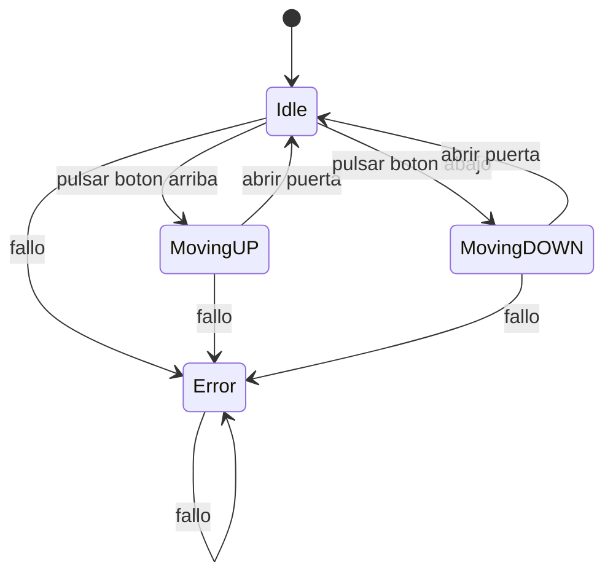

# Examen PMDM

## Diagrama de estados

En mi programa tengo 4 estados

4 posiciones donde puede estar el ascensor

4 metodos

este metodo comprueba que al pulsar el boton de bajar si esta en la poscion Pcompostela si esta ahi, el ascensor baja y pasa a posicion movimiento

este metodo comprueba que al pulsar el boton de subir si esta en la poscion GarciaBarbon si esta ahi, el ascensor sube y pasa a posicion movimiento

este metodo registra si se esta moviendo el ascensor, cuando llega abre las puesta y pasa a estado idle y cambia la posicion a la que es

registra el error y cambia el estado y posicion a error

comprobacion de que los test funcionan
